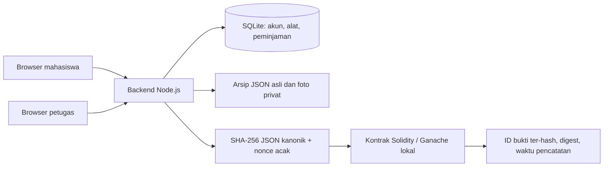

# LabPass — prototipe peminjaman Lab Radar

MVP lokal untuk proyek kelompok mata kuliah Blockchain. Database, backend, frontend, dan smart contract sudah terhubung. Semua akun, unit alat, dan nomor inventaris merupakan **data dummy**, bukan sistem atau data resmi ITB.

## Menjalankan

Memerlukan Node.js **22.18 atau lebih baru** dengan `node:sqlite` dan npm. Versi yang diuji adalah 22.18.0. Koneksi internet diperlukan saat pertama memasang dependensi.

1. Instal Node.js dari [situs resmi](https://nodejs.org/en/download) jika belum tersedia. Di Windows, gunakan **Windows Installer (.msi)** dan biarkan opsi **Add to PATH** aktif. Tutup terminal lama setelah instalasi, lalu cek `node -v` dan `npm -v` di terminal baru.
2. Clone repo atau ekstrak ZIP kode ke folder biasa.
3. Di Windows, klik dua kali `Mulai-LabPass.cmd`. Launcher akan menjalankan `npm ci` jika dependensi belum tersedia. Untuk menjalankan lewat terminal, buka folder LabPass, jalankan `npm ci` sekali, lalu `npm start`.
4. Setelah muncul tulisan **LabPass siap**, buka alamat yang tercetak di terminal. Alamat defaultnya **http://127.0.0.1:8787**. Biarkan terminal tetap terbuka.
5. Hentikan dengan `Ctrl+C`. Data akan dipakai kembali saat aplikasi dijalankan lagi.

Jika muncul pesan `node is not recognized`, buka Command Prompt baru setelah instalasi. Jika `node -v` masih gagal, jalankan ulang installer Node.js dan periksa opsi **Add to PATH**.

Jika port sedang digunakan, atur `$env:PORT=8790` pada PowerShell sebelum `npm start`, lalu buka port tersebut. Server hanya menerima koneksi dari komputer lokal.

### Mengambil perbaikan terbaru

Hentikan server dengan `Ctrl+C`, lalu di GitHub Desktop pilih repo LabPass, klik **Fetch origin** dan **Pull origin** bila tersedia. Jalankan `Mulai-LabPass.cmd` kembali dan muat ulang browser. Data demo yang sudah ada tetap dipakai; reset merupakan langkah terpisah. Untuk pengguna ZIP, ekstrak kode baru ke folder terpisah dan ikuti langkah instalasi. Simpan folder demo lama jika buktinya masih dibutuhkan.

## Akun demo

### Mulai cepat untuk penguji

1. Jalankan LabPass dengan langkah instalasi di atas, lalu buka alamat lokal yang tercetak.
2. Login manual sebagai **Alya** dengan ID `mhs-1` dan kata sandi `demo123` pada browser biasa. Gunakan ID `staff-zaenal` dengan kata sandi yang sama pada jendela Incognito. Kedua jendela memisahkan sesi akun.
3. Alya mengajukan alat yang tersedia. Pak Zaenal membuka pengajuan, menyetujui, lalu mengisi checklist serah terima. Foto serah terima awal dapat ditambahkan langsung di formulir pemeriksaan sebelum menyimpan.
4. Di halaman detail Alya, klik **Perbarui status**, lalu konfirmasi penerimaan. Alya mengajukan pengembalian. Pak Zaenal memperbarui status, mengisi pemeriksaan kembali, dan dapat menambahkan foto pengembalian. Alya memperbarui status dan mengonfirmasi hasilnya.
5. Pada riwayat, gunakan **Salin tx hash** atau **Verifikasi** untuk memeriksa bukti. Untuk kasus penolakan kontrak, ikuti [uji pencatatan ID ganda di Remix VM](PANDUAN-TESTING.md#uji-smart-contract-di-remix-vm).

Foto opsional. Sistem mengelompokkan foto berdasarkan tahap peminjaman. Setelah petugas menyimpan pemeriksaan, foto tahap itu dikunci selama menunggu konfirmasi. Foto pada database versi lama ditampilkan sebagai **Foto lama, tahap belum tercatat**. Bukti dan arsip lama tetap dapat diverifikasi.

Masukkan ID akun pada form login. Semua kata sandi dummy adalah `demo123`.

| ID | Peran | Nama simulasi |
|---|---|---|
| `staff-zaenal` | Petugas | Pak Zaenal — akun dummy |
| `staff-pkl` | Petugas | Petugas PKL — akun dummy |
| `mhs-1` | Mahasiswa | Alya |
| `mhs-2` | Mahasiswa | Bima |
| `mhs-3` | Mahasiswa | Citra |
| `mhs-4` | Mahasiswa | Dimas |
| `mhs-5` | Mahasiswa | Elin |

Untuk mencoba dua peran bersamaan, gunakan browser biasa untuk mahasiswa dan jendela incognito/browser lain untuk petugas. Dua tab biasa berbagi sesi login. Alternatifnya, keluar dan masuk kembali menggunakan akun peran berikutnya.

Tampilan default meminta ID dan kata sandi. Pintasan akun demo hanya tersedia jika server dijalankan dengan `LABPASS_DEMO_SHORTCUTS=1`. Akun dan kata sandi ini merupakan data simulasi yang terdokumentasi. Untuk versi yang diakses melalui internet, pengelolaan akun dan kata sandi perlu disiapkan kembali.

Setiap komputer yang menjalankan server lokal memiliki database dan chain sendiri. Untuk melihat pengajuan yang sama, mahasiswa dan petugas harus memakai server yang sama. Saat demo lokal, gunakan dua jendela di komputer yang sama. Tombol **Perbarui** memuat transaksi yang tersimpan pada server itu.

## Membatalkan sebelum alat diterima

Mahasiswa bisa memilih **Batalkan peminjaman** saat pengajuan masih diajukan, disetujui, atau menunggu konfirmasi penerimaan. Jika petugas sudah mencatat kondisi awal, mahasiswa tetap dapat membatalkan selama belum menekan konfirmasi penerimaan. Unit kembali tersedia, riwayat kondisi awal tetap tersimpan, dan pembatalan setelah pemeriksaan mendapat bukti blockchain baru. Setelah penerimaan dikonfirmasi, gunakan alur pengembalian.

## Reset demo dengan cadangan

1. Hentikan server LabPass dengan `Ctrl+C` pada terminal yang menjalankannya.
2. Klik dua kali `Reset-Demo-LabPass.cmd`, atau jalankan `npm run reset-demo`.
3. Ketik `RESET` pada pertanyaan konfirmasi.
4. Seluruh folder `data` dipindahkan ke `backups/data-<waktu>`, termasuk database, foto, arsip, chain dan kunci operator.
5. Jalankan `Mulai-LabPass.cmd`. Data dummy dan kontrak lokal baru akan dibuat. Muat ulang browser, lalu login lagi.

Reset menolak berjalan jika server masih aktif. Ia berlaku untuk folder `data` bawaan project. Folder `backups` diabaikan Git karena berisi data dan kunci dari demo lama. Untuk memulihkan suatu cadangan, hentikan server dan pindahkan keseluruhan folder cadangan kembali sebagai `data` setelah menyimpan folder data yang sedang dipakai.

## Alur demo

1. **Mahasiswa:** pilih unit yang tersedia, isi tujuan, nama dosen terkait, tanggal mulai dan rencana kembali. Klik kirim pengajuan.
2. **Petugas:** buka Kelola peminjaman, pilih pengajuan, setujui. Alat menjadi dipesan sehingga pengajuan lain tidak dapat disetujui untuk unit tersebut.
3. **Petugas:** catat serah terima dengan kondisi dan jumlah kelengkapan. Foto opsional PNG/JPEG maksimal 3 MB dapat ditambahkan sebelum konfirmasi. Hasil pemeriksaan membuat komitmen bukti pertama di blockchain.
4. **Mahasiswa:** buka ulang detail melalui Peminjaman saya agar status terbaru dimuat. Periksa kondisi lalu konfirmasi penerimaan. Alat menjadi dipinjam. Konfirmasi menghasilkan bukti baru.
5. **Mahasiswa:** ajukan pengembalian. Alat belum langsung tersedia.
6. **Petugas:** periksa pengembalian, isi jumlah kelengkapan dan kondisi alat.
7. **Mahasiswa:** buka ulang detail dan konfirmasi hasil pemeriksaan. Transaksi selesai. Alat lengkap/baik tersedia kembali; alat rusak atau kurang lengkap masuk pemeriksaan.
8. **Keduanya:** pada riwayat, pilih Verifikasi. Periksa kecocokan database, arsip asli, komitmen chain, identitas saat ini, dan foto yang masuk bukti. Coba Simulasikan NIM berubah: hanya salinan JSON kandidat yang berubah, sehingga hasil kandidat tidak cocok.

Petugas dapat menolak pengajuan dengan alasan. Mahasiswa dapat membatalkan sebelum mengonfirmasi penerimaan alat, termasuk setelah pemeriksaan awal petugas. Alat yang selesai diperiksa dapat ditandai tersedia oleh petugas. Proses perbaikan dan pengadaan belum dimodelkan.

## Scope dan keputusan sementara

- Satu lab, delapan unit alat, satu unit per pengajuan. Dua board RL mempunyai ID internal berbeda. ID tersebut bukan nomor inventaris resmi.
- Lima mahasiswa dummy dan dua akun petugas; akun tidak dihapus setiap pergantian semester.
- Pak Zaenal dan petugas PKL memakai peran aplikasi `staff`. Ini penyederhanaan operasional MVP, bukan klaim struktur jabatan resmi.
- Nama dosen hanya informasi pengajuan. Persetujuan dosen, Bu Irma, kaprodi, dan hierarki aset belum menjadi tahapan sistem; perlu dikonfirmasi sebelum penggunaan nyata.
- Beberapa mahasiswa boleh mengajukan unit yang sama saat tersedia. Persetujuan pertama memesan unit secara eksklusif; ini bukan penjadwalan kalender atau reservasi per jam.
- Tidak mencakup sengketa, ganti rugi, pengadaan, penghapusan aset, pembayaran, WhatsApp, SSO kampus, atau deployment publik.

## Arsitektur



Frontend: HTML/CSS/JavaScript tanpa dependensi CDN. Backend: Node.js HTTP dengan sesi cookie HttpOnly, pemeriksaan peran dan kepemilikan. Database: SQLite dengan foreign key, transaksi, dan indeks unik untuk mencegah dua peminjaman aktif atas satu unit. Blockchain: Ganache EVM lokal, ethers, dan solc. Kontrak dikompilasi dan dipasang otomatis saat aplikasi pertama dijalankan, lalu digunakan kembali setelah restart.

Tabel dibuat dan diisi otomatis dalam `lib/database.js`: `users`, `assets`, `asset_components`, `loans`, `loan_events`, `evidence_records`, `attachments`.

Status peminjaman:

```text
REQUESTED → APPROVED → HANDOVER_PENDING → BORROWED
          → RETURN_REQUESTED → RETURN_PENDING → CLOSED

REQUESTED → REJECTED
REQUESTED / APPROVED / HANDOVER_PENDING → CANCELLED
```

Baris kedua pada jalur utama melanjutkan `BORROWED`. Status alat terpisah: AVAILABLE, RESERVED, BORROWED, INSPECTION.

## Yang dibuktikan blockchain

Kontrak menerima `keccak256(ID bukti)` dan digest SHA-256 dari JSON bukti lengkap. JSON mencakup identitas peminjam saat pencatatan, unit alat, detail pengajuan, aktor, checklist, hash foto, waktu aplikasi, dan nonce acak. NIM, nama, foto, dan JSON lengkap tetap off-chain. Nonce membantu mencegah tebakan hash sederhana atas identitas yang mudah ditebak.

Kontrak hanya menerima operator yang ditetapkan saat deployment dan tidak menyediakan penimpaan bukti. Koreksi seharusnya berupa kejadian/bukti baru. Tampilan menunjukkan tx hash, block, dan gas dari transaksi nyata pada EVM lokal. Jika chain gagal, bukti berstatus FAILED; petugas dapat mencoba lagi melalui Bukti & jaringan.

**Model kepercayaan MVP adalah backend-custodial:** satu backend memegang kunci operator. Konfirmasi dua pihak berasal dari dua akun aplikasi, bukan dua tanda tangan wallet independen. Administrator backend tetap dipercaya mengautentikasi pengguna dan memasukkan data. Ini belum membuktikan bahwa peminjam benar-benar menerima alat secara fisik, dan belum memberikan ketahanan terhadap pengelola komputer yang dapat mengganti seluruh database serta chain lokal. Database dengan audit log tetap layak menjadi pembanding.

Jika NIM pada tabel akun diubah, pemeriksaan identitas saat ini akan berbeda dari snapshot bukti lama. Arsip asli menyimpan identitas pada saat pencatatan; komitmen on-chain membantu memeriksa keutuhannya. **Hash tidak dapat mengembalikan NIM atau foto yang hilang.** Arsip asli dan backup tetap diperlukan. Untuk demo perubahan kandidat, sistem tidak menyentuh database atau arsip asli.

## Penyimpanan dan backup

Folder `data/` diabaikan Git dan berisi:

- `labpass.sqlite` beserta file WAL/SHM saat aktif: database aplikasi.
- `archives/`: JSON kanonik bukti asli, tidak ditimpa ketika retry.
- `uploads/`: foto dengan nama file internal acak.
- `chain/`: riwayat EVM lokal.
- `contract.json`: alamat kontrak dan informasi deployment.
- `wallet-seed.json`: rahasia pembentuk akun operator lokal. Jangan dibagikan atau diunggah.

Hentikan aplikasi, lalu salin **seluruh folder data** untuk backup yang konsisten. Jangan hanya menyalin SQLite atau hanya chain. Jangan menghapus `wallet-seed.json` ketika memakai chain lama. Saat memindahkan kode untuk kerja kelompok, bagikan kode serta `package-lock.json`; setiap anggota dapat menghasilkan data dan chain lokal sendiri.

Menghapus folder data berarti menghilangkan seluruh transaksi demo dan bukti lokal. Aplikasi tidak melakukan penghapusan otomatis. Sesi login tidak disimpan setelah restart; masuk ulang menggunakan akun demo yang sama.

## Pengujian

Untuk demo smart contract di browser, ikuti [Panduan uji Remix VM](PANDUAN-TESTING.md#uji-smart-contract-di-remix-vm). Kontrak yang dipakai adalah [LabPass.sol](contracts/LabPass.sol). Untuk menguji alur aplikasi lengkap dengan Ganache lokal, ikuti [uji utama](PANDUAN-TESTING.md#uji-utama).

`npm test` menjalankan pengujian dengan database dan chain terpisah di direktori sementara. `npm run check` memeriksa sintaks JavaScript.

Teruji: hak akses pemilik/petugas, pemesanan unit eksklusif, kelengkapan wajib, konfirmasi peminjam, lifecycle pengembalian, deteksi perubahan identitas/arsip/JSON kandidat, hash foto, kontrak menolak operator lain dan overwrite, kegagalan chain serta retry, dan persistensi kontrak/operator/bukti setelah restart. Browser juga diuji untuk alur pengajuan sampai selesai, verifikasi kandidat yang diubah, dan tampilan 390 px.

Ganache dapat menampilkan peringatan µWS lalu memakai implementasi JavaScript pada Node 22 Windows. SQLite juga dapat menampilkan ExperimentalWarning. Pada lingkungan yang diuji, keduanya tidak menghalangi aplikasi atau pengujian.

## Langkah bersama kelompok berikutnya

Review alur dengan anggota kelompok, pilih data alat dummy yang paling familiar, dan konfirmasi batas persetujuan petugas/dosen. Sebelum dipakai lab sungguhan, perlu keputusan identitas resmi, pengelolaan akun, persetujuan institusi, backup terpisah, dan siapa yang menjalankan node/kunci. Integrasi SSO atau wallet serta deployment testnet merupakan pengembangan lanjutan, belum termasuk MVP ini.
