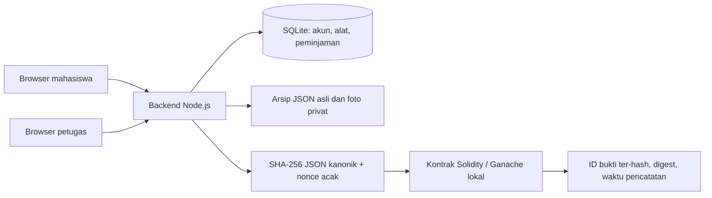

# LabPass — prototipe peminjaman Lab Radar

MVP lokal untuk proyek kelompok mata kuliah Blockchain. Database, backend, frontend, dan smart contract sudah terhubung. Semua akun, unit alat, dan nomor inventaris merupakan **data dummy**, bukan sistem atau data resmi ITB.

## Menjalankan

Memerlukan Node.js **22.18 atau lebih baru pada versi 22**, atau Node.js versi baru yang menyediakan `node:sqlite`. Versi yang diuji: 22.18.0. Tidak memerlukan MetaMask, akun cloud, database terpisah, saldo kripto, atau koneksi internet setelah dependensi terpasang.

1. Buka terminal di folder `LabPass` ini.
2. Jalankan `npm install` jika dependensi belum tersedia. Di komputer pengembangan ini sudah terpasang.
3. Jalankan `npm start`, atau klik dua kali `Mulai-LabPass.cmd` di Windows.
4. Buka **http://127.0.0.1:8787** di browser. Biarkan terminal tetap terbuka.
5. Hentikan dengan `Ctrl+C` pada terminal. Data akan dipakai kembali saat aplikasi dijalankan lagi.

Jika port sedang digunakan, atur `$env:PORT=8790` pada PowerShell sebelum `npm start`, lalu buka port tersebut. Server hanya menerima koneksi dari komputer lokal.

## Akun demo

Pilih langsung pada halaman masuk. Semua kata sandi: `demo123`.

| ID | Peran | Nama simulasi |
|---|---|---|
| `staff-zaenal` | Petugas | Pak Zaenal — akun dummy |
| `staff-pkl` | Petugas | Petugas PKL — akun dummy |
| `mhs-1` | Mahasiswa | Alya |
| `mhs-2` | Mahasiswa | Bima |
| `mhs-3` | Mahasiswa | Citra |
| `mhs-4` | Mahasiswa | Dimas |
| `mhs-5` | Mahasiswa | Elin |

Untuk mencoba dua peran bersamaan, gunakan browser biasa untuk mahasiswa dan jendela incognito/browser lain untuk petugas. Dua tab biasa berbagi sesi login. Alternatifnya, keluar dan masuk kembali menggunakan akun peran berikutnya.

## Alur demo

1. **Mahasiswa:** pilih unit yang tersedia, isi tujuan, nama dosen terkait, tanggal mulai dan rencana kembali. Klik kirim pengajuan.
2. **Petugas:** buka Kelola peminjaman, pilih pengajuan, setujui. Alat menjadi dipesan sehingga pengajuan lain tidak dapat disetujui untuk unit tersebut.
3. **Petugas:** catat serah terima dengan kondisi dan jumlah kelengkapan. Foto opsional PNG/JPEG maksimal 3 MB dapat ditambahkan sebelum konfirmasi. Hasil pemeriksaan membuat komitmen bukti pertama di blockchain.
4. **Mahasiswa:** buka ulang detail melalui Peminjaman saya agar status terbaru dimuat. Periksa kondisi lalu konfirmasi penerimaan. Alat menjadi dipinjam. Konfirmasi menghasilkan bukti baru.
5. **Mahasiswa:** ajukan pengembalian. Alat belum langsung tersedia.
6. **Petugas:** periksa pengembalian, isi jumlah kelengkapan dan kondisi alat.
7. **Mahasiswa:** buka ulang detail dan konfirmasi hasil pemeriksaan. Transaksi selesai. Alat lengkap/baik tersedia kembali; alat rusak atau kurang lengkap masuk pemeriksaan.
8. **Keduanya:** pada riwayat, pilih Verifikasi. Periksa kecocokan database, arsip asli, komitmen chain, identitas saat ini, dan foto yang masuk bukti. Coba Simulasikan NIM berubah: hanya salinan JSON kandidat yang berubah, sehingga hasil kandidat tidak cocok.

Petugas dapat menolak pengajuan dengan alasan. Mahasiswa dapat membatalkan pengajuan sebelum serah terima dimulai. Alat yang selesai diperiksa dapat ditandai tersedia oleh petugas; proses perbaikan dan pengadaan tidak dimodelkan.

## Scope dan keputusan sementara

- Satu lab, delapan unit alat, satu unit per pengajuan. Dua board RL mempunyai ID internal berbeda. ID tersebut bukan nomor inventaris resmi.
- Lima mahasiswa dummy dan dua akun petugas; akun tidak dihapus setiap pergantian semester.
- Pak Zaenal dan petugas PKL memakai peran aplikasi `staff`. Ini penyederhanaan operasional MVP, bukan klaim struktur jabatan resmi.
- Nama dosen hanya informasi pengajuan. Persetujuan dosen, Bu Irma, kaprodi, dan hierarki aset belum menjadi tahapan sistem; perlu dikonfirmasi sebelum penggunaan nyata.
- Beberapa mahasiswa boleh mengajukan unit yang sama saat tersedia. Persetujuan pertama memesan unit secara eksklusif; ini bukan penjadwalan kalender atau reservasi per jam.
- Tidak mencakup sengketa, ganti rugi, pengadaan, penghapusan aset, pembayaran, WhatsApp, SSO kampus, atau deployment publik.

## Arsitektur



Frontend: HTML/CSS/JavaScript tanpa dependensi CDN. Backend: Node.js HTTP dengan sesi cookie HttpOnly, pemeriksaan peran dan kepemilikan. Database: SQLite dengan foreign key, transaksi, dan indeks unik untuk mencegah dua peminjaman aktif atas satu unit. Blockchain: Ganache EVM lokal, ethers, dan solc. Kontrak dikompilasi dan dipasang otomatis saat aplikasi pertama dijalankan, lalu digunakan kembali setelah restart.

Tabel dibuat dan diisi otomatis dalam `lib/database.js`: `users`, `assets`, `asset_components`, `loans`, `loan_events`, `evidence_records`, `attachments`.

Status peminjaman:

```text
REQUESTED → APPROVED → HANDOVER_PENDING → BORROWED
          → RETURN_REQUESTED → RETURN_PENDING → CLOSED

REQUESTED → REJECTED
REQUESTED / APPROVED → CANCELLED
```

Baris kedua pada jalur utama melanjutkan `BORROWED`. Status alat terpisah: AVAILABLE, RESERVED, BORROWED, INSPECTION.

## Yang dibuktikan blockchain

Kontrak menerima `keccak256(ID bukti)` dan digest SHA-256 dari JSON bukti lengkap. JSON mencakup identitas peminjam saat pencatatan, unit alat, detail pengajuan, aktor, checklist, hash foto, waktu aplikasi, dan nonce acak. NIM, nama, foto, dan JSON lengkap tetap off-chain. Nonce membantu mencegah tebakan hash sederhana atas identitas yang mudah ditebak.

Kontrak hanya menerima operator yang ditetapkan saat deployment dan tidak menyediakan penimpaan bukti. Koreksi seharusnya berupa kejadian/bukti baru. Tampilan menunjukkan tx hash, block, dan gas dari transaksi nyata pada EVM lokal. Jika chain gagal, bukti berstatus FAILED; petugas dapat mencoba lagi melalui Bukti & jaringan.

**Model kepercayaan MVP adalah backend-custodial:** satu backend memegang kunci operator. Konfirmasi dua pihak berasal dari dua akun aplikasi, bukan dua tanda tangan wallet independen. Administrator backend tetap dipercaya mengautentikasi pengguna dan memasukkan data. Ini belum membuktikan bahwa peminjam benar-benar menerima alat secara fisik, dan belum memberikan ketahanan terhadap pengelola komputer yang dapat mengganti seluruh database serta chain lokal. Database dengan audit log tetap layak menjadi pembanding.

Jika NIM pada tabel akun diubah, pemeriksaan identitas saat ini akan berbeda dari snapshot bukti lama. Arsip asli menyimpan identitas pada saat pencatatan; komitmen on-chain membantu memeriksa keutuhannya. **Hash tidak dapat mengembalikan NIM atau foto yang hilang.** Arsip asli dan backup tetap diperlukan. Untuk demo perubahan kandidat, sistem tidak menyentuh database atau arsip asli.

## Penyimpanan dan backup

Folder `data/` diabaikan Git dan berisi:

- `labpass.sqlite` beserta file WAL/SHM saat aktif: database aplikasi.
- `archives/`: JSON kanonik bukti asli, tidak ditimpa ketika retry.
- `uploads/`: foto dengan nama file internal acak.
- `chain/`: riwayat EVM lokal.
- `contract.json`: alamat kontrak dan informasi deployment.
- `wallet-seed.json`: rahasia pembentuk akun operator lokal. Jangan dibagikan atau diunggah.

Hentikan aplikasi, lalu salin **seluruh folder data** untuk backup yang konsisten. Jangan hanya menyalin SQLite atau hanya chain. Jangan menghapus `wallet-seed.json` ketika memakai chain lama. Saat memindahkan kode untuk kerja kelompok, bagikan kode serta `package-lock.json`; setiap anggota dapat menghasilkan data dan chain lokal sendiri.

Menghapus folder data berarti menghilangkan seluruh transaksi demo dan bukti lokal. Aplikasi tidak melakukan penghapusan otomatis. Sesi login tidak disimpan setelah restart; masuk ulang menggunakan akun demo yang sama.

## Pengujian

`npm test` menjalankan pengujian dengan database dan chain terpisah di direktori sementara. `npm run check` memeriksa sintaks JavaScript.

Teruji: hak akses pemilik/petugas, pemesanan unit eksklusif, kelengkapan wajib, konfirmasi peminjam, lifecycle pengembalian, deteksi perubahan identitas/arsip/JSON kandidat, hash foto, kontrak menolak operator lain dan overwrite, kegagalan chain serta retry, dan persistensi kontrak/operator/bukti setelah restart. Browser juga diuji untuk alur pengajuan sampai selesai, verifikasi kandidat yang diubah, dan tampilan 390 px.

Ganache dapat menampilkan peringatan µWS lalu memakai implementasi JavaScript pada Node 22 Windows. SQLite juga dapat menampilkan ExperimentalWarning. Pada lingkungan yang diuji, keduanya tidak menghalangi aplikasi atau pengujian.

## Langkah bersama kelompok berikutnya

Review alur dengan anggota kelompok, pilih data alat dummy yang paling familiar, dan konfirmasi batas persetujuan petugas/dosen. Sebelum dipakai lab sungguhan, perlu keputusan identitas resmi, pengelolaan akun, persetujuan institusi, backup terpisah, dan siapa yang menjalankan node/kunci. Integrasi SSO atau wallet serta deployment testnet merupakan pengembangan lanjutan, belum termasuk MVP ini.
